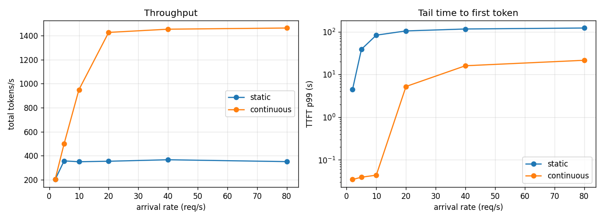

# Day 24: Continuous batching revisited — a scheduler simulator

Book chapter: **0.3 revisit (continuous batching)**

Task: simulate static and continuous batching on the same requests, and compare
throughput and latency.

## What we built

`batching_sim.py` is pure Python (no model, no GPU). It replays the same 500
requests through two schedulers:

- **Static batching**: when the GPU is free, take whoever is waiting (up to 32)
  and run that group until its **longest** answer is done. Then repeat.
- **Continuous batching**: before every decode step, finished users leave and
  waiting users take the free seats.

The requests:

- They arrive at random (a Poisson process) at 2 to 80 requests per second.
- Prompts are 20–400 tokens long.
- 80% have short answers (10–60 tokens) and 20% have long ones (200–500). That
  mix is where static batching hurts.

The cost model is based on day 22's Mac GPU measurements:

- one decode step costs `6 ms + 0.35 ms × batch size`, because the weights are
  read once for everyone (day 12);
- prefill costs 0.05 ms per prompt token.

It prints a table and saves `batching_sim.png`.

```
python3 days/day-24/batching_sim.py
```

It takes under a second.

## What we learned

### Why static batching wastes the GPU

```
answers of 2, 5 and 3 tokens   (x = making a token, . = seat held but idle)
static:      A:xx...  B:xxxxx  C:xxx..
continuous:  A:xx     B:xxxxx  C:xxx      A's seat goes to a new user after step 2
```

With static batching, one long answer keeps the whole group's seats locked. New
arrivals wait outside, even though most seats are doing nothing.

### What to measure

- **Total tok/s:** what the GPU produces. This is what makes inference cheap.
- **TTFT p50 / p99:** how long users wait before anything appears. p99 shows
  the unlucky ones.
- **E2E (end to end):** the time until the whole answer is done.
- **Short E2E:** the average for short answers only. These are the users that
  static batching treats worst: they wait for someone else's 500-token answer.
- **Avg batch:** users actually making a token at each step.

## Results

```
500 requests, max batch 32, 20% long answers. Times in ms.

req/s  scheduler   tok/s  TTFT p50  TTFT p99  E2E p50  E2E p99 short E2E avg batch
----------------------------------------------------------------------------------
    2     static     201      1269      4460     2048     6851      1800       1.8
    2 continuous     203        13        35      296     3328       251       1.9
    5     static     356     17557     38898    18801    40505     18213       5.8
    5 continuous     499        14        39      336     4043       297       3.9
   10     static     349     37559     83121    38771    84533     40181       5.8
   10 continuous     950        17        44      464     5485       415      10.0
   20     static     354     49496    104502    50321   105084     50726       5.9
   20 continuous    1427      2159      5226     3082    12143      2744      24.4
   40     static     366     56165    115963    56816   116136     55541       6.3
   40 continuous    1453      7325     15991     9078    20708      7939      25.7
   80     static     350     56889    122202    57900   122800     60164       5.9
   80 continuous    1463      9952     21469    11643    25562     10626      26.2
```



- **Throughput:** static batching tops out at about **350 tok/s**, because on
  average only ~6 of its seats are working. Continuous batching reaches about
  **1,450 tok/s**, about 4× more on the same "GPU", with ~26 seats working.
- **At 2 req/s nobody waits,** so both give the same throughput. Static still
  makes users wait over a second for the first token, because a new request
  waits for the running group to finish.
- **At 5–10 req/s static batching is already overloaded:** the queue grows and
  TTFT climbs to 17–37 s. Continuous batching still answers in ~15 ms.
- **Past ~20 req/s, both are overloaded.** Even continuous batching has a limit
  (about 1,450 tok/s here), and above it the queue grows and TTFT climbs.
  Batching moves the limit; it does not remove it.

## Connection to earlier days

- Day 6: p50 vs p99, and total vs per-user throughput.
- Day 12: why a bigger batch costs almost nothing per step (decode is
  memory-bound).
- Day 22: we built continuous batching for real. This simulator shows why it
  was worth it, without the noise of a real server.

## Caveats

- The cost model is a straight line. Real GPUs fall off a cliff at some batch
  size (day 22: MPS at 64), and prefill and decode share the GPU in more
  complicated ways.
- Prefill runs one request at a time, before the decode step, and pauses
  everyone else (like day 22). Real engines use **chunked prefill** to mix
  prefill and decode in one step.
- No KV memory limit: every seat is assumed to fit. Day 25 is about that limit.
- Static batching here takes whoever is waiting. Waiting to fill the batch
  first would make TTFT even worse.

## Things to try

1. Set `LONG_SHARE = 0` (all answers short): how close does static get?
2. Change `MAX_BATCH` to 8 and 128.
3. Add a "max wait" to static batching: start the group when it is full or
   after 50 ms, whichever comes first.
