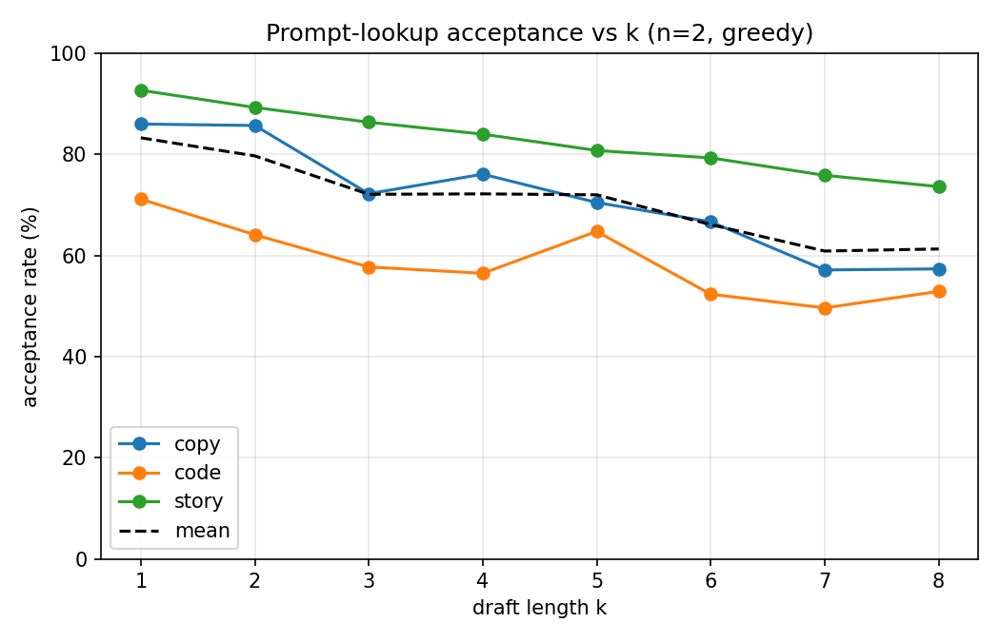

# Day 31: Prompt-lookup (n-gram) decoding

Book chapter: **5.2 Speculative decoding (continued)**

Task: build speculative decoding with no draft model. The context drafts
itself, and plot acceptance rate against draft length `k`.

## What we built

`prompt_lookup_decoding.py` runs greedy decoding on `gpt2-medium` with one
change: before each target pass, find the most recent earlier occurrence of the
last `n` tokens and propose up to `k` tokens that followed it. The target
checks all proposals in one forward pass.

- `lookup_draft`: backwards scan for the suffix, then slice the continuation.
- `prompt_lookup_decode`: draft, verify, accept the matching prefix, emit one
  correction (or a bonus token), then `rewind` the KV cache.
- `normal_decode`: the baseline, one token per pass.
- A sweep over `k = 1..8` for three prompts, plus the acceptance plot.

Run:

```
python3 days/day31-prompt-lookup/prompt_lookup_decoding.py
python3 days/day31-prompt-lookup/prompt_lookup_decoding.py --quick
```

The script asserts that every speculative run produces **exactly** the same
tokens as normal greedy decoding.

## How one step works

```
tokens: ... the quick brown fox jumps over the lazy dog ...
                        ^ last n=2 tokens: "lazy dog"

earlier match: "lazy dog again" -> propose " again", ...
target pass:   last token + k proposals -> k+1 logits
accept:        proposal == target argmax, left to right
on mismatch:   emit the target's token, discard the rest
all accepted:  emit one bonus token from the last logit
rewind:        crop the KV cache back to the emitted prefix
```

The proposal is free: it is a list scan, not a forward pass. That is the whole
difference from day 30, where the draft model cost 43% of a target pass.

The suffix search starts at `len(tokens) - n - 1`, so it never matches the
suffix against itself. A continuation may overlap the current suffix; that is
what lets periodic text (lists, repeated phrases) keep drafting.

## What we learned

### Acceptance falls with `k`, but throughput still rises

Acceptance is per proposed token: `accepted / drafted`. A longer draft has to
match the target at every position, and each position is conditioned on all
earlier drafts being right, so acceptance usually falls as `k` grows.

But tokens per pass grows faster. Copy at `k = 8`: 96 tokens in **20 target
passes**, 4.8 tokens per pass, acceptance 57.4%. With no draft-model cost, the
cost model is simply

```
speedup ≈ tokens_per_pass × t_target / t_check(k+1)
```

Checking 9 positions costs about 29 ms versus 24 ms for one, so the ideal is
about 4x; the measured 3.25x pays for the lookup scan, Python, and rejected
work.

### Repetition is the whole game

Prompt lookup can only propose text that already exists in the context. It is
excellent when the model copies or repeats, and useless when every next token
is new.

- **copy**: repeats a paragraph, 86.0% -> 57.4% acceptance, 1.48x -> 3.25x.
- **code**: reuses identifiers and statement shapes, 71.2% -> 52.9%, up to 3.15x.
- **story**: unexpectedly repetitive too — `gpt2-medium` at greedy decoding
  loops ("a detective who is also a writer"), so acceptance starts at 92.7% and
  still reaches 2.70x. This is a property of the model, not of the prompt
  being easy.

Acceptance is not monotonic in `k` (code rises at `k = 5`): the most recent
n-gram match changes as the context grows, so different passes draft from
different places.

### No model, no extra VRAM

Unlike day 30, there is no second model to load and no `q` distribution to
compute. The drafter is the token list you already have. The price is that
proposals are copied continuations: prompt lookup cannot invent a novel token,
and its ceiling is how repetitive the output is.

### Greedy only

This version accepts a draft iff it equals the target's argmax. That makes the
output identical by construction. A stochastic version needs day 30's
accept/reject rule (`min(1, p/q)`, resample from `max(0, p-q)`); a plain
argmax check would change the distribution.

## Results (Apple M4, Mac GPU)

`gpt2-medium`, greedy, 96 new tokens, n-gram `n = 2`, best of 2 runs.

| k | copy accept | copy speed | code accept | code speed | story accept | story speed |
|---|---|---|---|---|---|---|
| 1 | 86.0% | 1.48x | 71.2% | 1.46x | 92.7% | 1.40x |
| 2 | 85.7% | 1.90x | 64.1% | 1.73x | 89.3% | 1.75x |
| 3 | 72.2% | 1.88x | 57.7% | 2.12x | 86.4% | 1.89x |
| 4 | 76.1% | 2.45x | 56.5% | 2.53x | 84.0% | 2.20x |
| 5 | 70.5% | 2.48x | 64.8% | 2.92x | 80.8% | 2.09x |
| 6 | 66.7% | 2.96x | 52.3% | 2.76x | 79.3% | 2.13x |
| 7 | 57.1% | 2.90x | 49.6% | 2.58x | 75.9% | 2.60x |
| 8 | 57.4% | 3.25x | 52.9% | 3.15x | 73.6% | 2.70x |

Baseline: 42.5 tok/s (copy), 37.2 tok/s (code), 43.0 tok/s (story). The
baseline differs by prompt because the first forward pass includes prefill.



At `k = 8`, copy runs at 137.9 tok/s and code at 117.5 tok/s. Acceptance drops,
but the target pass count drops much more: 96 -> 20 passes for copy.

## Connection to earlier days

- **Day 30:** the same verify/accept/rewind loop, with the draft model replaced
  by a suffix match. Day 30's draft can propose new tokens but costs 43% of a
  target pass; this draft is free but can only copy.
- **Day 13:** the KV cache and `crop` after rejected proposals. Proposals for
  tokens past the accepted prefix are computed and then thrown away.
- **Day 12:** why checking `k+1` positions is cheap: the weights are read once,
  and decode at batch 1 leaves compute idle.
- **Day 11:** greedy decoding. This script deliberately does not sample.
- **Day 22/24:** batch-size-1 optimization. At a full batch there is no spare
  compute, so engines disable speculation under load.
- **Day 26:** prefix caching matches blocks by hash; prompt lookup is the same
  idea at token granularity, without a cache.

## Caveats

- Greedy only; no accept/reject probabilities. Not distribution-preserving for
  sampled decoding.
- `n = 2` fixed. `n = 1` matches almost everywhere but proposes noise; larger
  `n` finds fewer matches but more reliable ones. The script has `--ngram` but
  the plot uses 2.
- One proposal per pass, not a tree. Engines also try several n-gram lengths
  and multiple candidates.
- The suffix scan is O(context) per pass in Python. At these lengths it is
  negligible, but real engines keep an n-gram index.
- `gpt2-medium` loops at greedy, which flatters acceptance. A model with more
  varied output would show lower numbers.
- Timings on MPS are noisy; the script keeps the fastest of two runs.

## Things to try

1. Run `--ngram 1`, `--ngram 3`, `--ngram 4`. Where does acceptance beat `n=2`,
   and where does coverage collapse?
2. Add a longest-match fallback: try `n=4`, then 3, then 2.
3. Make `k` adaptive: draft less after a rejection, more after a fully
   accepted pass.
4. Test a real copy workload: a RAG prompt with a quoted passage, or a
   summarization prompt that echoes names and dates.
5. Add day 30's stochastic accept/reject and sweep temperature. Acceptance
   should fall as the target distribution flattens.
